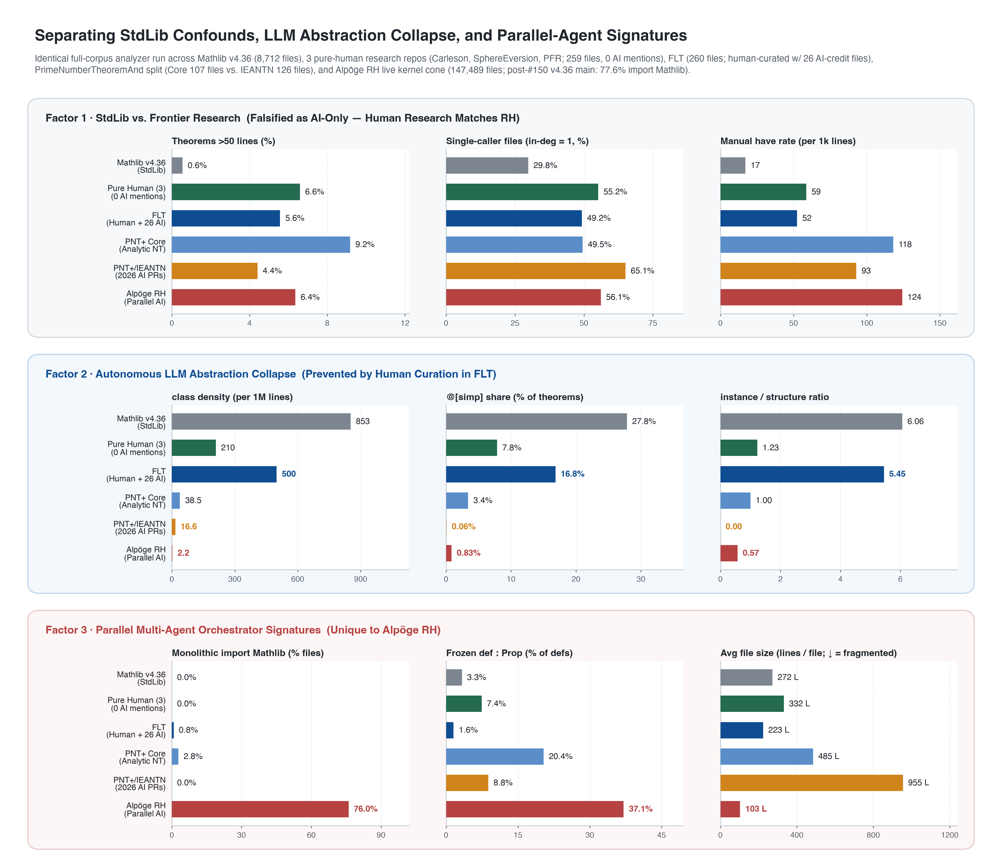
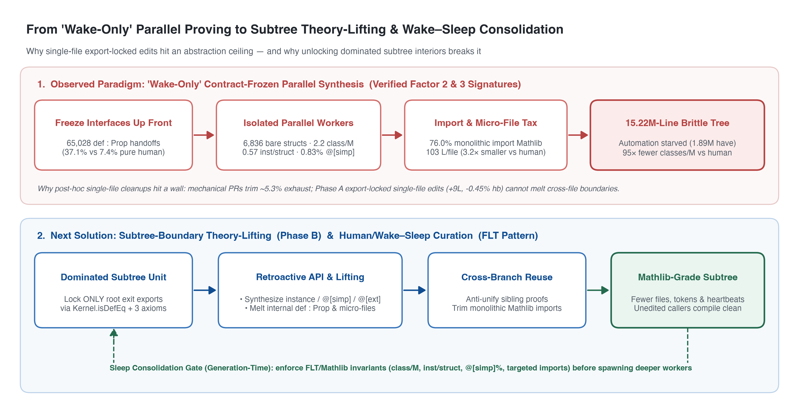

# Why a Multi-Agent LLM Proof Bloats to 17.37M Lines — Separating StdLib Confounds, LLM Abstraction Collapse, and Parallel-Agent Signatures

*Perspective note: written from an LLM-systems engineering angle by someone who knows a bit of math, not a research number theorist. Every statistic below comes from running the exact same source analyzer ([`src/compare_mathlib.py`](src/compare_mathlib.py), [`src/compare_human_baselines.py`](src/compare_human_baselines.py), [`src/anatomy.py`](src/anatomy.py)) across Mathlib (`v4.36`), five flagship Lean 4 frontier research repositories (`Carleson`, `SphereEversion`, `PFR`, `FLT`, and `PrimeNumberTheoremAnd`), and all `147,489` kernel-live modules of Levent Alpöge's Riemann Hypothesis archive (`alpo.ge`).*

---

## 1. The Puzzle: What Survives After Every Mechanical Cleanup?

Following Levent Alpöge's 17,374,215-line, 175,187-file Lean 4 formalization of the Riemann Hypothesis and Dirichlet GRH — and the Lean FRO / Mathlib Initiative certification — contributors on [`leanprover-community/riemann-hypothesis`](https://github.com/leanprover-community/riemann-hypothesis) quickly shipped mechanical and targeted cleanups (dead-module pruning in #45 and #66, thin `*Statement.lean` wrapper collapsing in #58/#61/#120, `maxHeartbeats` removal in #79/#134, explicit typeclass-dump rewriting in #57/#60/#65/#62/#150, and semantic reuse such as #68 and #94/`8071ca2be8`).

Yet exact mutually exclusive line accounting over the `147,489` kernel-live modules (`15,218,364` lines, aligned via `vincitamore`'s exact kernel dependency cone) shows that surface mechanical exhaust is only ~5% of live lines:

| Layer in Live Kernel Cone (`147,489` files) | Live Lines | Share of Live Cone |
|---|---:|---:|
| `*Statement.lean` & `first \| exact @...` glue files | `691,632` | `4.54%` |
| Strict explicit machine-dump files (`inst_\d+` / `.{u_\d+` / `Eq.{`, `717` files) | `114,282` | `0.75%` |
| `maxHeartbeats` override lines | `~76,000` | `~0.50%` |
| **Remaining clean, non-wrapper, non-dump live code** | **`14,412,450`** | **`94.70%`** |

*(Module bundling such as #63/#120 cuts file count and Lake process-startup overhead, while leaving the underlying proof lines largely unchanged.)*

So the deeper LLM-systems question is not *"why are there dead files or wrapper scripts?"* — it is: **why do 14.4 million lines of clean, live, non-wrapper Lean code remain after stripping surface orchestrator exhaust, and which structural signatures are genuinely caused by AI vs. frontier research proofs in general?**

---

## 2. Adding the Missing Control Group: Mathlib vs. Five Human Frontier Research Formalizations vs. AI RH

Comparing an end-point research formalization only against **Mathlib** risks an apples-to-oranges confound: Mathlib is a reusable standard library designed for maximal generality and short library lemmas, whereas a research project drives toward a deep theorem.

To test which gaps survive a true **human frontier research control group**, we ran the exact same analyzer across five flagship Lean 4 research repositories ([`data/three_way_comparison.json`](data/three_way_comparison.json)):

- **Pure Human Research (`3` repos, `259` files, `85,921` lines, `0` AI-tool mentions anywhere in `.lean` source):** `Carleson` (`124` files, `49,511`L), `SphereEversion` (`64` files, `14,861`L), and `PFR` (`71` files, `21,549`L).
- **Human-Curated Research with AI Assistance (`FLT`, `260` files, `58,042` lines):** `26` files explicitly credit Claude/Codex in comments/prose, yet strict human maintainers enforce Mathlib-grade architecture and review.
- **Within-Repo Natural Ablation (`PrimeNumberTheoremAnd`, `233` files, `172,194` lines):** split into `PNT+ Core` (excluding `IEANTN`, `107` files, `51,898`L, human-led analytic number theory) vs. `PNT+/IEANTN` (`126` files, `120,296`L, heavily built via 2026 single-agent AI PRs).

| Corpus | Files | Lines | Avg L/f | `class`/1M | `inst`/`struct` | `@[simp]`% | `@[ext]`/1M | `def:Prop`% | `have`/1k | `>50L`% | `in=1`% | `import Mathlib`% |
|---|---:|---:|---:|---:|---:|---:|---:|---:|---:|---:|---:|---:|
| **Mathlib v4.36 (StdLib)** | 8,712 | 2,368,060 | 272 | 852.6 | 6.06 | 27.84% | 589.5 | 3.29% | 17.1 | 0.55% | 29.8% | 0.0% |
| `Carleson` *(0 AI)* | 124 | 49,511 | 399 | 303.0 | 1.83 | 4.65% | 20.2 | 3.47% | 49.5 | 7.44% | 49.2% | 0.0% |
| `SphereEversion` *(0 AI)* | 64 | 14,861 | 232 | 0.0 | 0.43 | 17.03% | 807.5 | 11.82% | 36.4 | 2.31% | 56.2% | 0.0% |
| `PFR` *(0 AI)* | 71 | 21,549 | 304 | 139.2 | 4.60 | 7.73% | 0.0 | 15.52% | 95.2 | 8.52% | 64.8% | 0.0% |
| **Pure Human Research (3 repos, 0 AI)** | **259** | **85,921** | **332** | **209.5** | **1.23** | **7.85%** | **151.3** | **7.41%** | **58.7** | **6.59%** | **55.2%** | **0.0%** |
| **`FLT` *(human-curated, 26 AI files)*** | 260 | 58,042 | 223 | **499.6** | **5.45** | **16.84%** | **241.2** | **1.55%** | 52.4 | 5.57% | 49.2% | 0.8% |
| **Human-Curated Research (4 repos)** | **519** | **143,963** | **277** | **326.5** | **2.49** | **10.80%** | **187.5** | **4.39%** | **56.2** | **6.25%** | **52.2%** | **0.4%** |
| `PNT+ Core` *(excl. IEANTN)* | 107 | 51,898 | 485 | 38.5 | 1.00 | 3.39% | 19.3 | 20.36% | 118.2 | 9.18% | 49.5% | 2.8% |
| **`PNT+/IEANTN` *(2026 AI PRs)*** | 126 | 120,296 | 955 | **16.6** | **0.00** | **0.06%** | **0.0** | 8.81% | 92.9 | 4.41% | 65.1% | 0.0% |
| **Alpöge RH Live Cone (Parallel AI)** | **147,489** | **15,218,364** | **103** | **2.2** | **0.57** | **0.83%** | **6.8** | **37.07%** | **124.3** | **6.36%** | **56.1%** | **76.0%** |

*(Post-#150 check on Lean 4.36 `main` commit `c592e91eb8`: `115,739 / 149,098 = 77.63%` of `src/` files still import root `Mathlib` via `public import Mathlib` — confirming monolithic root imports remain intact after the Lean 4.36 upgrade. Note also that the released RH archive has `0` comments and `0` `/--` docstrings vs. `15.2–32.8` docstrings/1k lines across all human repos, reflecting release packaging rather than proof mechanics.)*

---

## 3. Orthogonal 3-Factor Decomposition (Including Two Falsified Claims)

Adding the five research control repos **falsifies two claims from our initial Mathlib-only scan** and sharpens the diagnosis into **three orthogonal causal factors**:

### Factor 1 — StdLib vs. Frontier Research (*Falsified as AI-Specific!*)
Two metrics that looked dramatically elevated against Mathlib turn out to be **normal properties of end-point frontier research proofs**, NOT AI-specific pathologies:
- **Share of theorems `>50` lines:** RH is `6.36%`, which **matches** Pure Human Research (`6.59%`, with `Carleson` `7.44%`, `PFR` `8.52%`, and `PNT+ Core` `9.18%`). Mathlib's `0.55%` is a standard-library style effect.
- **Single-caller module ratio (`in-deg = 1`):** RH is `56.1%`, which **matches** Pure Human Research (`55.2%`, with `SphereEversion` `56.2%`, `PFR` `64.8%`, `Carleson` `49.2%`). End-point research proof graphs naturally narrow into chains near target theorems, unlike Mathlib's reusable DAG (`29.8%`).
- **Analytic-NT `have` density:** RH (`124.3`/1k) is `2.1×` above Pure Human Research (`58.7`/1k), but nearly matches human-led `PNT+ Core` (`118.2`/1k) — indicating that explicit inequality-chaining in analytic number theory explains much of the `have` rate, while automation starvation amplifies it.

### Factor 2 — Autonomous LLM Abstraction Collapse (*Prevented by Human Curation in `FLT`*)
Even after controlling for frontier research, **autonomous LLM proof generation exhibits an order-of-magnitude collapse in Lean's abstraction and automation layer** — visible in **both** single-agent `PNT+/IEANTN` and multi-agent `Alpöge RH`:
- **`class` density:** `209.5`/1M in Pure Human (`326.5`/1M in 4-repo Human-Curated) → collapses to **`16.6`/1M** in `PNT+/IEANTN` and **`2.2`/1M** in Alpöge RH (**`95×` below Pure Human**, **`148×` below 4-repo Human-Curated**).
- **`@[simp]` share:** `7.85%` in Pure Human (`10.80%` in 4-repo Human-Curated) → collapses to **`0.06%`** in `PNT+/IEANTN` and **`0.83%`** in Alpöge RH (**`9.5×–13×` lower**).
- **`instance / structure` & `@[ext]`:** `1.23` inst/struct & `151.3` `@[ext]`/1M in Pure Human (`2.49` & `187.5` in 4-repo Human-Curated) → collapses to **`0.00` / `0.0`** in `PNT+/IEANTN` and **`0.57` / `6.8`** in Alpöge RH (**`22×–28×` fewer `@[ext]`**).
- **The `FLT` natural control (`26` AI-credit files, yet Mathlib-grade metrics):** `FLT` explicitly credits Claude and Codex in `26` files, yet maintains `499.6` classes/1M, `5.45` inst/struct, `16.84%` `@[simp]`, `241.2` `@[ext]`/1M, and `1.55%` `def : Prop`. **Using LLMs does not inherently cause abstraction collapse; removing human architectural curation ("human-in-the-loop Sleep") does.**

### Factor 3 — Parallel Multi-Agent Orchestrator Signatures (*Unique to Alpöge RH*)
Three extreme signatures appear **only in Alpöge RH** — absent from Mathlib, absent from pure human research, and absent even from single-agent AI PRs in `PNT+/IEANTN`:
- **Monolithic `import Mathlib`:** **`76.0%`** of live RH files (`77.6%` on post-#150 v4.36 `main`) vs. **`0.0%–2.8%`** across every other corpus (`0.0%` in Pure Human and `PNT+/IEANTN`) — directly explaining the `51.6%` import-loading CPU share reported in `leanprover-community/riemann-hypothesis#250`.
- **Frozen `def ... : Prop :=` handoff contracts:** **`37.07%`** of all `def`s (`65,028 / 175,424`) vs. `7.41%` in Pure Human (`4.39%` in 4-repo Human-Curated, `1.55%` in `FLT`, `8.81%` in `PNT+/IEANTN`) — **`5.0×–8.4×` higher** because stateless parallel workers require frozen proposition interfaces up front.
- **Micro-file fragmentation:** **`103` lines/file** vs. `223–955` lines/file across all five research repos (`3.2×` smaller than Pure Human `332`L/file, `9.3×` smaller than `PNT+/IEANTN` `955`L/file). Combined with monolithic `import Mathlib`, this multiplies environment deserialization cost across `147,489` separate Lean processes.

### A Natural Within-Corpus Experiment (Inside Alpöge RH Itself)
Comparing two zero-dump files inside the **very same RH archive** isolates the Factor 2 abstraction mechanism directly:

| File (both 0-dump, same RH archive) | Lines | `class` / `instance` | `@[simp]` / `@[ext]` | `have` count (`per 1k`) | Longest thm |
|---|---:|---:|---:|---:|---:|
| `Development/.../Foundations/MemUnitaryGroupIffIsIsometry.lean` | `923` | `1` / `6` (`4` structs) | **`54`** / **`3`** | **`3`** (`3.2/1k`) | `31 L` |
| `Formalism/.../StationaryPhaseModel.lean` | `3,321` | `0` / `0` (`1` struct, `23` defs) | **`0`** / **`0`** | **`641`** (`193/1k`, **60×**) | `126 L` |

In the rare RH module where the synthesizer built a Mathlib-style API layer (`class` + `instance` + `@[simp]` + `@[ext]`), proof ergonomics immediately matched human Mathlib. And cross-subtree inspection reveals verbatim multi-file duplication across isolated worker branches (e.g., an 8-file proof of `RealMetaplecticRepresentationHolds` duplicated between `CompanionTheory.ThickeningEstimates.LieGroupReduction.MetaplecticRepresentation` and `Development.WeilBound.ThetaLifts.Reductions.MetaplecticDerivatives`).

---

## 4. Controlled Experiments: From Single-File Null Result (Phase A) to Subtree Theory-Lifting (Phase B)

### Phase A — Single-File Export-Locked Pilot (`MonoCount.lean`): An Honest Null Result
To test whether local abstraction lifting inside a **single export-locked file** can break past the ceiling without altering module boundaries, we validated our two-module kernel equivalence oracle ([`oracle/OracleAudit.lean`](oracle/OracleAudit.lean)) and ran a matched A/B on `Formalism/PolynomialDimension/MultinomialDepth/MonoCount.lean` (`1,878`L, `28,806` normalized tokens, `152` locked public exports, `24` locked public `def`s, `4` direct downstream importers compiled unchanged — [`experiments/phase-a/README.md`](experiments/phase-a/README.md)):

- **Arm A (local simplification, 0 warnings):** `1,873`L, `29,299` tokens, `168,158` heartbeats.
- **Arm B (+4 shared private lemmas, 0 warnings):** `1,882`L (`+9`L), `29,472` tokens (`+173`), `167,402` heartbeats (`-0.45%`).

**Diagnosis of the null result:** When all `152` public declarations of a single file are locked at the file boundary, you cannot melt cross-file `def : Prop` handoffs, collapse fragmented single-caller micro-files, or equip shared cross-file `structure`s with `@[simp]`/`@[ext]`/`instance` bundles.

### Phase B — Pre-Registered Multi-File Dominated Subtree Theory-Lifting A/B *(In Progress)*
To directly test whether **unlocking the interior of a dominated multi-file subtree** (while keeping ONLY the top-level exit boundary 100% kernel-locked via `OracleAudit --subtree-boundary`, `lean4checker` replay, and unedited external caller builds) breaks past Phase A's ceiling, we pre-registered **three strictly dominated multi-file subtrees** in [`experiments/phase-b/manifest.json`](experiments/phase-b/manifest.json) (commit `bfcc50a`, verified `0` external callers to any non-root internal module across all `149,098` `src/` files at `c592e91eb8`, each matching `MonoCount.lean`'s ~28k–30k token scale):

1. **`B3_alexander_whitney`** (`Development.AutomorphicArithmetic.CommutativeAlgebra.ProductLevelwiseOfAlexanderWhitney`): `15` files, `1,733`L, `29,227` tokens, **`7` bare `structure`s** (`0` `@[simp]`, `0` `@[ext]`), **`15/15` `public import Mathlib`**, `1` external caller (`PurTop`) referencing **zero** internal symbols (pure single-theorem sealed boundary).
2. **`B1_final_har`** (`Formalism.PolynomialDimension.FinalHar`): `6` files, `2,101`L, `27,884` tokens, **`0` external RH dependencies** (pure Mathlib closure), `def : Prop` handoff contracts + `21` `set_option`s across 4 internal proof files behind 7 exported theorems.
3. **`B2_real_metaplectic`** (`CompanionTheory.ThickeningEstimates.LieGroupReduction.MetaplecticRepresentation.RealMetaplecticRepresentationHolds`): `13` files, `2,147`L, `30,029` tokens, `17` `def : Prop`, `1` bare `structure`, `365` `have`s, tiny 33-file full closure including both external callers.

To prevent confounding mechanical `#min_imports` trimming with genuine proof/theory refactoring, Phase B measures **both** matched-import (`A_same_imp` vs. `B_same_imp`) and minimal-import (`A_min_imp` vs. `B_min_imp`) wall-clock compile times alongside import-independent metrics (normalized tokens, `.ilean` bytes, and `#count_heartbeats` summed across all declarations). Results will be reported verbatim upon kernel verification.
