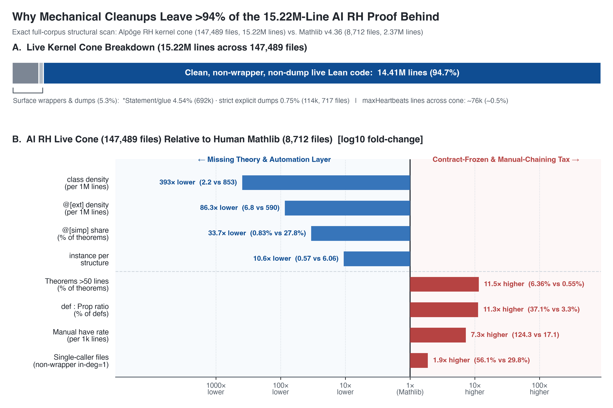
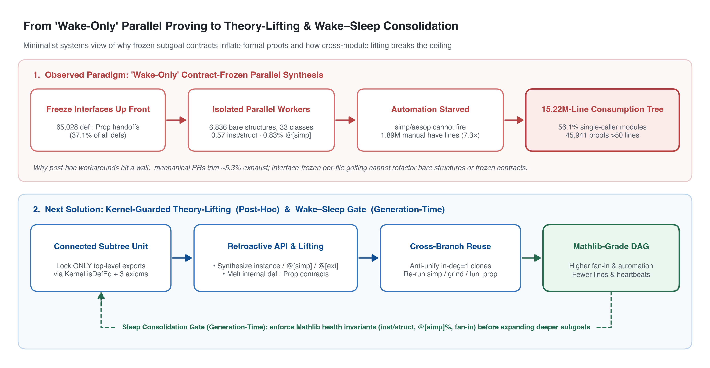

# ProofDistill — Empirical Anatomy of Million-Line AI Formal Proofs

An LLM-systems analysis of the 17.37M-line, 175,187-file Lean 4 formalization of the Riemann Hypothesis (`alpo.ge`), aligned against the exact kernel dependency cone (`147,489` live modules) and contrasted side-by-side with Mathlib (`8,712` modules, `2.37M` lines).

## Core Empirical Finding: Why Mechanical Cleanups Leave >94% of Live Lines Untouched

Surface orchestrator exhaust (dead modules, `*Statement.lean` thin glue wrappers, `maxHeartbeats` overrides, and explicit typeclass dumps) is already being cleaned up by community PRs in `leanprover-community/riemann-hypothesis` (#45, #55, #57, #58, #60, #61, #63, #65, #79). Quantifying each layer strictly across the `147,489` live in-cone modules (`15,218,364` lines):

- `*Statement.lean` & `first | exact @...` glue files: **`691,632` lines (`4.54%`)**
- Strict explicit machine-dump files (`inst_\d+` / `.{u_\d+` / `Eq.{`, `717` files): **`114,282` lines (`0.75%`)**
- `maxHeartbeats` override lines across the cone: **`~76,000` lines (`~0.50%`)**
- **Remaining clean, non-wrapper, non-dump live code**: **`14,412,450` lines (`94.70%` of the live cone)**

Comparing all `147,489` live RH modules (`15.22M` lines) against all `8,712` Mathlib modules (`2.37M` lines) surfaces four order-of-magnitude structural gaps that explain this post-mechanical bloat from an LLM-systems perspective (**Theory-less, Contract-Frozen Synthesis**):

| Metric (exact full-corpus scan) | Human Mathlib (`8,712` files) | AI RH In-Cone (`147,489` files) | Contrast |
|---|---:|---:|---|
| Total lines (avg / file) | `2,368,060` (`272` L/file) | `15,218,364` (`103` L/file) | `6.4x` lines, `16.9x` files |
| `class` declarations | `2,019` | `33` | **`393x` lower density / line** |
| `structure` vs `instance` | `1,833` / `11,111` (`6.06` inst/struct) | `6,836` / `3,915` (`0.57` inst/struct) | **`3.7x` structs, `10.6x` fewer instances/struct** |
| `@[simp]` density (`simp / thms`) | `51,114` (`27.84%`) | `5,973` (`0.83%`) | **`33.7x` lower automation density** |
| `@[ext]` attributes | `1,396` | `104` | **`86.3x` lower density / line** |
| `def ... : Prop :=` ratio | `3.29%` (`1,073 / 32,565`) | `37.07%` (`65,028 / 175,424`) | **`11.3x` frozen handoff contracts** |
| `have` density (per 1k lines) | `17.1` (`40,574`) | `124.3` (`1,891,600`) | **`7.3x` manual step-by-step chaining** |
| Theorems > 50 lines | `1,013` (`0.55%`) | `45,941` (`6.36%`) | **`11.5x` share (`45x` count)** |
| Single-caller modules (`in-deg = 1`) | `29.81%` (median `2`) | `61.35%` (`56.13%` excl. `*Statement`/glue, median `1`) | Tree-shaped consumption vs. Mathlib DAG |

*(Note: the released RH source archive also contains `0` comments and `0` `/--` docstrings vs. Mathlib's `77,649` docstrings; this reflects the release export / pipeline rather than proof logic itself.)*

## Beyond Mechanical Workarounds: Theory-Lifting & Wake–Sleep Consolidation

## Full Write-up & Related Work

- **[`ANALYSIS.md`](ANALYSIS.md)** — Full empirical write-up: the three-layer decomposition (orchestrator exhaust vs. "Theory-less, Contract-Frozen" abstraction tax vs. genuine Mathlib-missing frontier math), the within-corpus natural experiment (`MemUnitaryGroupIffIsIsometry.lean` vs. `StationaryPhaseModel.lean`), and the **Theory-Lifting** & **Wake–Sleep** engineering directions.
- **Related Lean 4 / Mathlib contributions:**
  - [`leanprover-community/riemann-hypothesis` commit `8071ca2be8`](https://github.com/leanprover-community/riemann-hypothesis/commit/8071ca2be8) (from [PR #94](https://github.com/leanprover-community/riemann-hypothesis/pull/94), merged via [#150](https://github.com/leanprover-community/riemann-hypothesis/pull/150)): reusing the quadratic Hasse norm theorem (`+34 / -1,703` lines).
  - [`leanprover-community/mathlib4#46371`](https://github.com/leanprover-community/mathlib4/pull/46371): `feat(NumberTheory/Chebyshev): transfer von Koch's bound to prime counting` (CI green).
  - [`leanprover-community/mathlib4#46372`](https://github.com/leanprover-community/mathlib4/pull/46372): `feat(NumberTheory/MillerPrimality): strong probable-prime test and Miller's criterion` (CI green).
  - [`hhh2210/rh-grh-consequences`](https://github.com/hhh2210/rh-grh-consequences): machine-checked Lean 4 consequences of RH and Dirichlet GRH (von Koch, Cramér short intervals, zero-density window, conditional Miller primality test).

## Repository Structure

- `ANALYSIS.md` — Full LLM-systems analysis of the 17.37M-line RH archive vs. Mathlib.
- `src/anatomy.py` — Full 175,187-file structural & tactic anatomy aligned against `cut-modules.txt.xz`.
- `src/compare_mathlib.py` — Side-by-side comparison of Mathlib vs. live RH cone (`class`, `structure`, `instance`, `@[simp]`, `@[ext]`, `def : Prop`, import in-degree, proof length).
- `src/lexer_metrics.py` — Comment-stripped, whitespace-normalized Lean 4 token counter (prevents single-line packing cheats).
- `oracle/OracleAudit.lean` — Generic Lean 4 kernel equivalence verifier (`loadExts := false`, exported decl coverage, kind, `levelParams`, binders, `Kernel.isDefEq` on types & `def` values, transitive axioms ⊆ standard 3).
- `data/anatomy_report.json` & `data/deep_causal_anatomy.json` — Measured outputs.
- `tests/test_lexer_metrics.py` — Unit tests (`python3 -m unittest`).

## License

Apache-2.0
