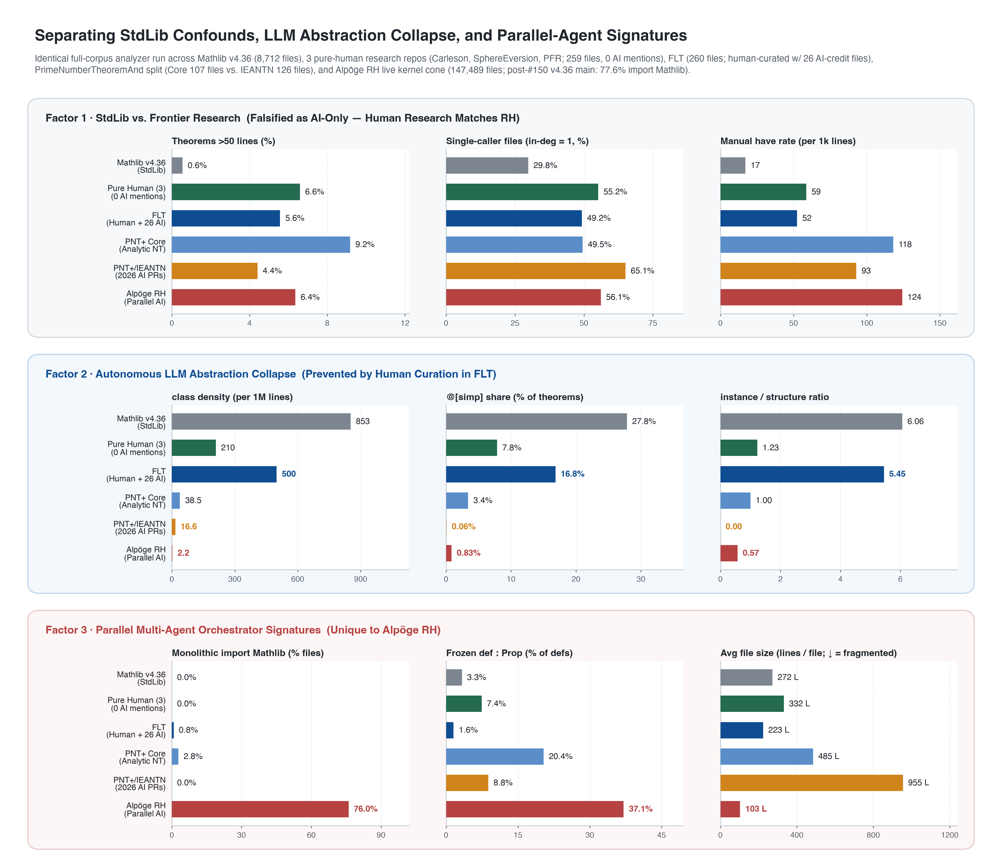

# ProofDistill — Empirical Anatomy & Subtree Distillation of Million-Line AI Formal Proofs

An LLM-systems study of the 17.37M-line, 175,187-file Lean 4 formalization of the Riemann Hypothesis (`alpo.ge`), aligned against its exact kernel dependency cone (`147,489` live modules, `15.22M` lines) and benchmarked side-by-side against **Mathlib v4.36** (`8,712` files) and **five flagship Lean 4 frontier research repositories** (`Carleson`, `SphereEversion`, `PFR`, `FLT`, and `PrimeNumberTheoremAnd` split into Core vs. IEANTN).

## Key Empirical Finding: An Orthogonal 3-Factor Decomposition

Mechanical cleanups (dead-module pruning, `*Statement.lean` wrappers `4.54%`, strict explicit machine dumps `0.75%`, `maxHeartbeats` overrides `~0.50%`) leave **`14,412,450` lines (`94.70%` of the live kernel cone)** untouched. Benchmarking all `147,489` live RH modules against both Mathlib **and** five human frontier research repositories ([`data/three_way_comparison.json`](data/three_way_comparison.json)) separates three distinct effects — **and falsifies two claims from our initial Mathlib-only comparison**:

| Corpus | Files | Lines | L/file | `class`/1M | `inst`/`struct` | `@[simp]`% | `@[ext]`/1M | `def:Prop`% | `have`/1k | `>50L`% | `in=1`% | `import Mathlib`% |
|---|---:|---:|---:|---:|---:|---:|---:|---:|---:|---:|---:|---:|
| **Mathlib v4.36 (StdLib)** | 8,712 | 2,368,060 | 272 | 852.6 | 6.06 | 27.84% | 589.5 | 3.29% | 17.1 | 0.55% | 29.8% | 0.0% |
| **Pure Human Research (`3` repos, `0` AI)** | **259** | **85,921** | **332** | **209.5** | **1.23** | **7.85%** | **151.3** | **7.41%** | **58.7** | **6.59%** | **55.2%** | **0.0%** |
| **`FLT` *(human-curated, 26 AI files)*** | 260 | 58,042 | 223 | **499.6** | **5.45** | **16.84%** | **241.2** | **1.55%** | 52.4 | 5.57% | 49.2% | 0.8% |
| `PNT+ Core` *(excl. IEANTN)* | 107 | 51,898 | 485 | 38.5 | 1.00 | 3.39% | 19.3 | 20.36% | 118.2 | 9.18% | 49.5% | 2.8% |
| **`PNT+/IEANTN` *(2026 AI PRs)*** | 126 | 120,296 | 955 | **16.6** | **0.00** | **0.06%** | **0.0** | 8.81% | 92.9 | 4.41% | 65.1% | 0.0% |
| **Alpöge RH Live Cone (Parallel AI)** | **147,489** | **15,218,364** | **103** | **2.2** | **0.57** | **0.83%** | **6.8** | **37.07%** | **124.3** | **6.36%** | **56.1%** | **76.0%** |

1. **Factor 1 — StdLib vs. Frontier Research (*falsified as AI-only*):** Theorems `>50` lines (`6.36%` RH vs. `6.59%` Pure Human) and single-caller modules (`56.1%` RH vs. `55.2%` Pure Human) are normal properties of end-point research formalizations, not AI pathologies.
2. **Factor 2 — Autonomous LLM Abstraction Collapse (*prevented by human curation in `FLT`*):** Both single-agent `PNT+/IEANTN` (`16.6` classes/1M, `0.06%` `@[simp]`, `0.00` inst/struct) and parallel `Alpöge RH` (`2.2` classes/1M, `0.83%` `@[simp]`, `0.57` inst/struct, `6.8` `@[ext]`/1M) collapse an order of magnitude below Pure Human Research (`209.5` classes/1M, `7.85%` `@[simp]`, `151.3` `@[ext]`/1M). Crucially, **`FLT` credits Claude/Codex in `26` files yet preserves Mathlib-grade metrics (`499.6` classes/1M, `5.45` inst/struct, `16.84%` `@[simp]`)** — showing that human architectural curation ("human-in-the-loop Sleep") prevents abstraction collapse.
3. **Factor 3 — Parallel Multi-Agent Orchestrator Signatures (*unique to Alpöge RH*):** Monolithic `import Mathlib` (`76.0%` live cone; `77.6%` on post-#150 v4.36 `main` `c592e91eb8` vs. `0.0%–2.8%` in all other repos), frozen `def : Prop` handoff contracts (`37.07%` vs. `1.55%–8.81%`), and micro-file fragmentation (`103` L/file vs. `223–955` L/file) appear only in the parallel multi-agent pipeline.

## Controlled Experiments: Phase A (Single-File Null) → Phase B (Multi-File Subtrees)

### Phase A · Single-File Export-Locked Pilot (`MonoCount.lean`)
Using our kernel equivalence oracle ([`oracle/OracleAudit.lean`](oracle/OracleAudit.lean), verified on Windows Lean `v4.36.0`: accepts a real refactor, rejects `sorryAx`, altered theorem type, altered `def` value, and missing export — [`oracle/README.md`](oracle/README.md)), we ran a matched A/B on `MonoCount.lean` (`1,878`L, `28,806` normalized tokens, `152` locked public exports, `24` locked public `def`s, all `4` direct downstream importers compiled unchanged — [`experiments/phase-a/README.md`](experiments/phase-a/README.md)):

| Pinned Windows Lean `4.36.0` build | Upstream | Arm A (local cleanup) | Arm B (+4 shared private lemmas) |
|---|---:|---:|---:|
| Raw lines | `1,878` | `1,873` | `1,882` |
| Comment-stripped tokens | `28,806` | `29,299` | `29,472` |
| Declaration heartbeats (sum) | `167,754` | `168,158` | `167,402` (`-0.45%` vs A) |
| Warnings (`-DwarningAsError`) | `87` | `0` | `0` |

**Honest takeaway:** Locking all `152` exports of a single file leaves proof size and elaboration cost virtually unchanged (`+9`L, `+173` tokens, `-0.45%` heartbeats).

### Phase B · Pre-Registered Multi-File Dominated Subtree Theory-Lifting *(Running)*
To test whether unlocking the interior of a **dominated multi-file subtree** (while locking ONLY the top-level exit contract via `OracleAudit --subtree-boundary`, `lean4checker` replay, and unedited external caller compilation) breaks past Phase A's ceiling, we pre-registered three strictly dominated subtrees in [`experiments/phase-b/manifest.json`](experiments/phase-b/manifest.json) (commit `bfcc50a`, verified `0` external callers to non-root internal modules across all `149,098` files at `c592e91eb8`, each ~28k–30k tokens):

| Subtree ID | Root Module | Files | Lines | Norm. Tokens | `import Mathlib` | External Callers | Targeted Pathology |
|---|---|---:|---:|---:|---:|---:|---|
| `B3_alexander_whitney` | `...ProductLevelwiseOfAlexanderWhitney` | 15 | 1,733 | 29,227 | 15 / 15 | 1 (`PurTop`, 0 internal refs) | 7 bare `structure`s (`0` simp/ext) + 15× `import Mathlib` behind 1 sealed theorem |
| `B1_final_har` | `...PolynomialDimension.FinalHar` | 6 | 2,101 | 27,884 | 1 / 6 | 2 | `0` ext RH deps (pure Mathlib) + `def : Prop` contracts + `21` `set_option`s |
| `B2_real_metaplectic` | `...RealMetaplecticRepresentationHolds` | 13 | 2,147 | 30,029 | 0 / 13 | 2 | 13 fragmented micro-files (`19L–341L`) + `17` `def : Prop` + 33-file total closure |

Each subtree compares **Upstream** vs. **Arm A (export-locked per-file)** vs. **Arm B (subtree-boundary theory-lifting)** with both matched-import and minimal-import wall-clock runs plus import-independent `#count_heartbeats` and normalized token metrics.

## Full Write-up & Related Contributions

- **[`ANALYSIS.md`](ANALYSIS.md)** — Full empirical write-up: 3-factor orthogonal decomposition across Mathlib, 5 research repos, and RH; natural within-corpus experiments (`FLT` vs. `PNT+/IEANTN`, `MemUnitaryGroupIffIsIsometry` vs. `StationaryPhaseModel`); Phase A & Phase B design.
- **Related Lean 4 / Mathlib contributions:**
  - [`leanprover-community/riemann-hypothesis` commit `8071ca2be8`](https://github.com/leanprover-community/riemann-hypothesis/commit/8071ca2be8) (from [PR #94](https://github.com/leanprover-community/riemann-hypothesis/pull/94), merged via [#150](https://github.com/leanprover-community/riemann-hypothesis/pull/150)): reusing the quadratic Hasse norm theorem (`+34 / -1,703` lines).
  - [`leanprover-community/mathlib4#46371`](https://github.com/leanprover-community/mathlib4/pull/46371): `feat(NumberTheory/Chebyshev): transfer von Koch's bound to prime counting` (CI green).
  - [`leanprover-community/mathlib4#46372`](https://github.com/leanprover-community/mathlib4/pull/46372): `feat(NumberTheory/MillerPrimality): strong probable-prime test and Miller's criterion` (CI green).
  - [`hhh2210/rh-grh-consequences`](https://github.com/hhh2210/rh-grh-consequences): machine-checked Lean 4 consequences of RH and Dirichlet GRH.

## Repository Structure

- `ANALYSIS.md` — Full LLM-systems analysis across Mathlib, 5 frontier research repos, and the RH live cone.
- `src/anatomy.py` — Full 175,187-file structural & tactic anatomy aligned against `cut-modules.txt.xz`.
- `src/compare_mathlib.py` & `src/compare_human_baselines.py` — Reproducible cross-corpus analyzer (`Mathlib`, `Carleson`, `SphereEversion`, `PFR`, `FLT`, `PrimeNumberTheoremAnd` Core vs. IEANTN, and RH).
- `src/lexer_metrics.py` — Comment-stripped, whitespace-normalized Lean 4 token counter.
- `src/make_figures.py` — Reproduces all vector SVG + 300 DPI PNG figures in `figures/`.
- `oracle/OracleAudit.lean` — Generic Lean 4 kernel equivalence verifier (`Kernel.isDefEq` on types & `def` values, transitive axioms ⊆ standard 3).
- `experiments/phase-a/` & `experiments/phase-b/` — Controlled A/B manifests, patches, and verification receipts.
- `data/` — Measured JSON outputs (`anatomy_report.json`, `deep_causal_anatomy.json`, `three_way_comparison.json`, `subtree_candidates.json`).
- `tests/test_lexer_metrics.py` — Unit tests (`python3 -m unittest`).

## License

Apache-2.0
